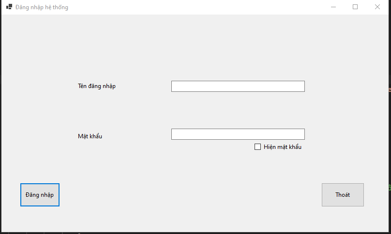
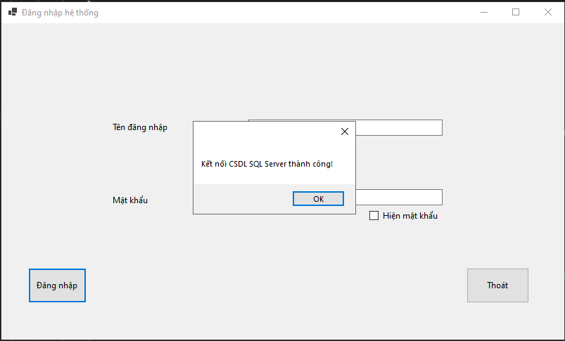
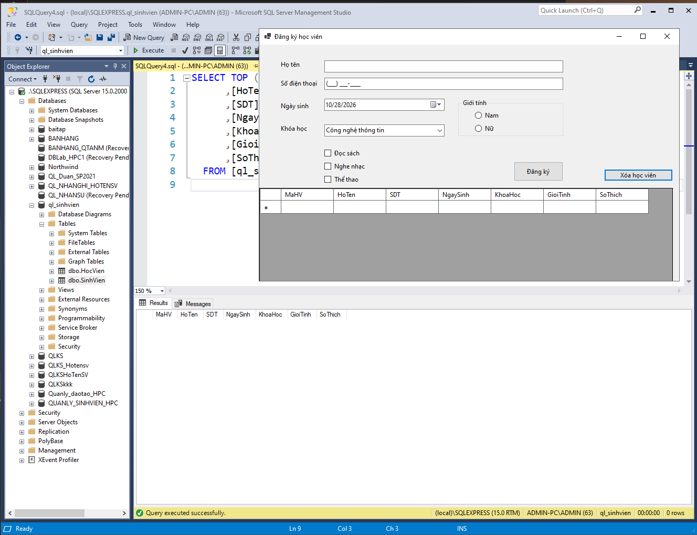
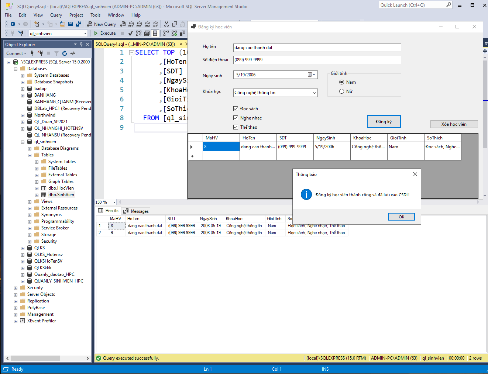
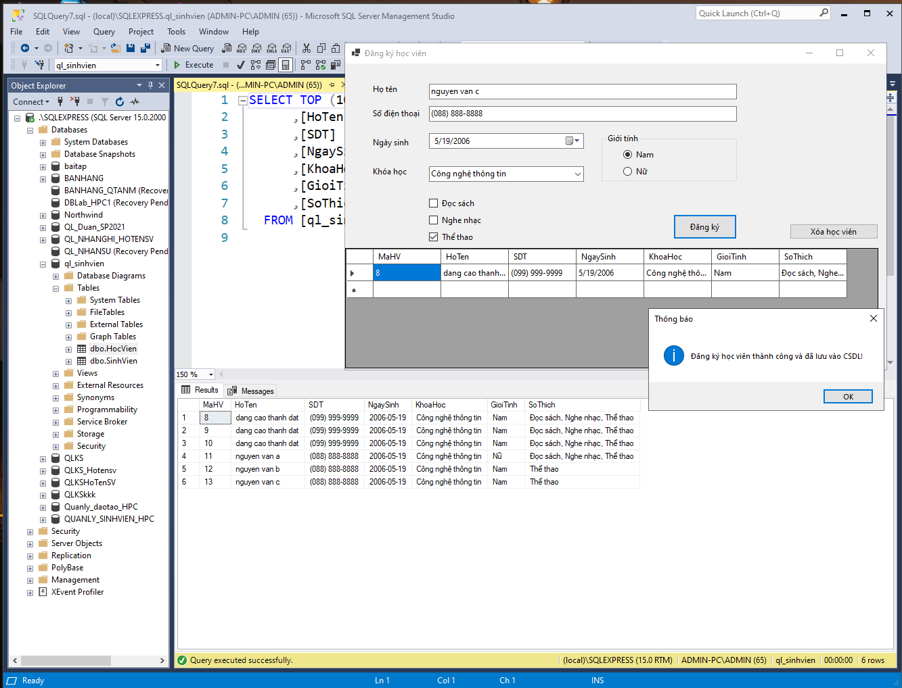

# BÁO CÁO BÀI TẬP THỰC HÀNH LẬP TRÌNH C# WINFORMS

## I. THÔNG TIN SINH VIÊN

* **Họ và tên:** Đặng Cao Thành Đạt
* **Mã số sinh viên:** 24810320215
* **Lớp học phần:** Lập trình .NET – Lớp: D19QTANM1
* **Link Repository:** https://github.com/datdct24810320215-cloud/LTNET-BAITAP5.1-5.2_24810320215_DangCaoThanhDat.git

---

## II. DANH SÁCH BÀI TẬP HOÀN THÀNH & TỰ ĐÁNH GIÁ

| Bài tập | Tiêu đề bài tập | Trạng thái | Mức độ hoàn thành (%) |
| :---: | :--- | :---: | :---: |
| **Bài 4.1** | Form Đăng nhập & Kết nối Cơ sở dữ liệu | Hoàn thành | 100% |
| **Bài 4.2** | Form Đăng ký Học viên & Lưu trữ CSDL | Hoàn thành | 100% |

---

## III. MINH HỌA GIAO DIỆN & KỸ THUẬT NỔI BẬT

### 1. Bài 4.1: Form Đăng nhập kết nối SQL Server
* **Kỹ thuật áp dụng:** Sử dụng thư viện `Microsoft.Data.SqlClient` để kết nối tới SQL Server. Sử dụng `ErrorProvider` để validation dữ liệu đầu vào (bắt lỗi bỏ trống). Xử lý ẩn/hiện mật khẩu.
* **Hình ảnh minh họa Giao diện:**



*Mô tả: Giao diện form đăng nhập với các chức năng kiểm tra dữ liệu rỗng.*



*Mô tả: Chương trình thực hiện kết nối tới CSDL `ql_sinhvien` trên SQL Server và thông báo thành công.*

---

### 2. Bài 4.2: Form Đăng ký Học viên (Lưu vào CSDL)
* **Kỹ thuật áp dụng:** Sử dụng Parameterized Query (`@HoTen`, `@SDT`...) với `SqlCommand` để chống lỗi SQL Injection. Sử dụng `MaskedTextBox` cho số điện thoại, `DateTimePicker` cho ngày sinh. Xử lý dữ liệu từ RadioButton (Giới tính) và CheckBox (Sở thích).
* **Hình ảnh minh họa Giao diện:**



*Mô tả: Giao diện nhập liệu thông tin học viên với đầy đủ các control.*



*Mô tả: Thông báo lưu dữ liệu thành công vào bảng HocVien.*



*Mô tả: Kiểm tra trực tiếp trên SQL Server Management Studio (SSMS), dữ liệu từ form đã được INSERT thành công vào bảng `dbo.HocVien`.*

---

## IV. HƯỚNG DẪN CÀI ĐẶT & CHẠY DỰ ÁN

**Yêu cầu hệ thống:** Đã cài đặt Visual Studio (.NET 8/9/10) và SQL Server (kèm SSMS).

1. **Clone Repository về máy:**
```bash
git clone https://github.com/datdct24810320215-cloud/LTNET-BAITAP5.1-5.2_24810320215_DangCaoThanhDat.git